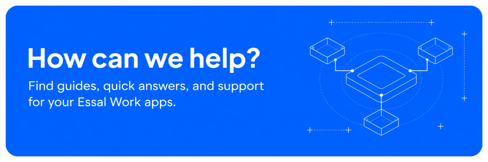

<h1 className="sr-only">How can we help?</h1>

Search for a task or an error message using the search bar above, or choose a topic below.

## What do you need help with?

<Columns cols={3}>
  <Card title="Sign in to your account" icon="key" href="/getting-started/sign-in" arrow>
    Recover access, use an invitation, or resolve a sign-in problem.
  </Card>

  <Card title="Set up your organization" icon="rocket" href="/getting-started/organization-setup" arrow>
    Get your workspace ready and complete your first task.
  </Card>

  <Card title="Members and permissions" icon="users-gear" href="/account/members-and-permissions" arrow>
    Invite colleagues and understand who can access what.
  </Card>

  <Card title="Billing and refunds" icon="credit-card" href="/billing/manage-purchases" arrow>
    Find invoices, manage a subscription, or request a refund.
  </Card>

  <Card title="Fix a problem" icon="wrench" href="/troubleshooting/common-problems" arrow>
    Check missing features, saving, uploads, and connectivity.
  </Card>

  <Card title="Privacy and your data" icon="user-shield" href="/privacy/manage-data" arrow>
    Find the right contact for data access and deletion requests.
  </Card>
</Columns>

## Explore your product

Start with the app you use. Each guide covers its own workflows, settings, and permissions.

<Columns cols={2}>
  <Card title="Essal Access" color="#0066FF" icon="id-card" href="/access/getting-started/what-is-essal-access" cta="Explore Access" arrow>
    Manage employees, design badges, welcome visitors, and use check-in devices.
  </Card>

  <Card title="Essal Talent" color="#7C3AED" icon="users" href="/talent/getting-started" cta="Explore Talent" arrow>
    Prepare jobs, review applications, and coordinate your hiring team.
  </Card>

  <Card title="Essal Project" color="#0891B2" icon="list-check" href="/project/getting-started" cta="Explore Project" arrow>
    Organize projects and tasks, collaborate, and keep track of your work.
  </Card>

  <Card title="Essal Guard" color="#16A34A" icon="shield-halved" href="/guard/getting-started" cta="Explore Guard" arrow>
    Find security-awareness guidance and the right route to report a concern.
  </Card>
</Columns>

## Useful guides to start with

<Columns cols={2}>
  <Card title="Add your first employee" icon="user-plus" horizontal href="/access/employee-management/adding-a-new-employee">
    Create an employee record in Access.
  </Card>

  <Card title="Understand a scan result" icon="qrcode" horizontal href="/access/check-in-devices/understanding-scan-results">
    Find out why a badge scan was granted or denied.
  </Card>

  <Card title="Prepare a job posting" icon="briefcase" horizontal href="/talent/jobs-and-career-page">
    Review the job and application form before publishing.
  </Card>

  <Card title="Create a project and task" icon="clipboard-check" horizontal href="/project/projects-and-tasks">
    Assign responsibility and follow progress.
  </Card>
</Columns>

## Quick answers

<AccordionGroup>
  <Accordion title="Why can’t I see a page or button?" icon="lock">
    Confirm the app and organization you are using, then check your role and the resource’s permissions. Ask your organization’s administrator for the specific access you need. See [members and permissions](/account/members-and-permissions).
  </Accordion>

  <Accordion title="Where can I find an invoice or cancel a subscription?" icon="receipt">
    Start with your purchase receipt. For Paddle purchases, use the links in the receipt or [paddle.net](https://paddle.net). For direct Essal purchases, follow [billing help](/billing/manage-purchases). Deleting an app account does not automatically cancel a subscription.
  </Accordion>

  <Accordion title="Who should I contact about a workplace record?" icon="address-book">
    Your employer or the organization responsible for an employee or applicant record is usually the right first contact. Use [privacy and data help](/privacy/manage-data) to identify the route for your request.
  </Accordion>
</AccordionGroup>

## Still need a hand?

<Columns cols={2}>
  <Card title="Contact support" icon="life-ring" href="/introduction/contact" cta="Get in touch" arrow>
    Tell us which app you use, what you tried, and the error you saw. We’ll help route your question.
  </Card>

  <Card title="Check service status" icon="signal" href="https://status.essal.cloud" cta="View status" arrow>
    Read published incidents and service updates when several people are affected.
  </Card>
</Columns>

Looking for policies? Visit the [Essal Legal Center](https://legal.essal.it.com) for terms, privacy, refunds, and other agreements.
